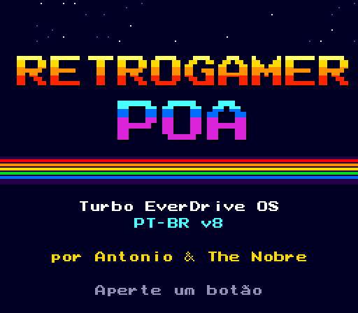
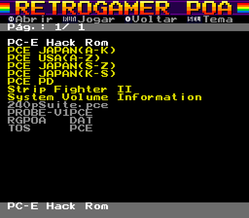
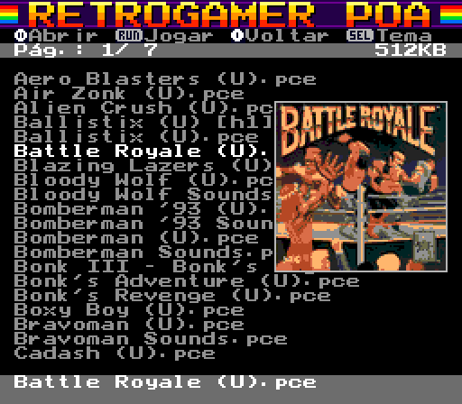
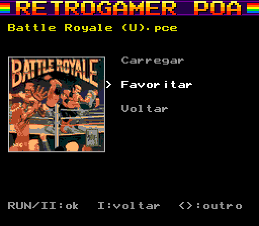
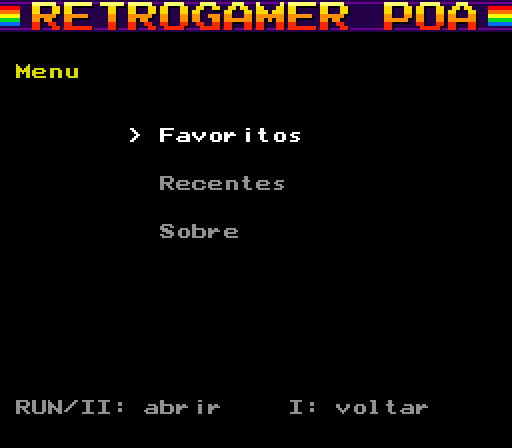
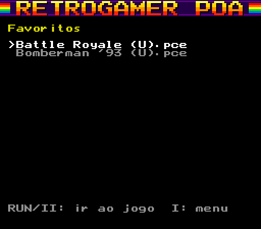
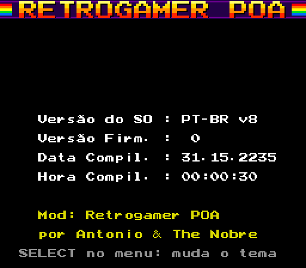
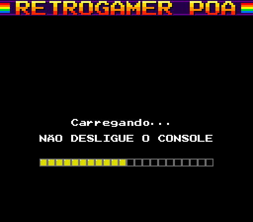
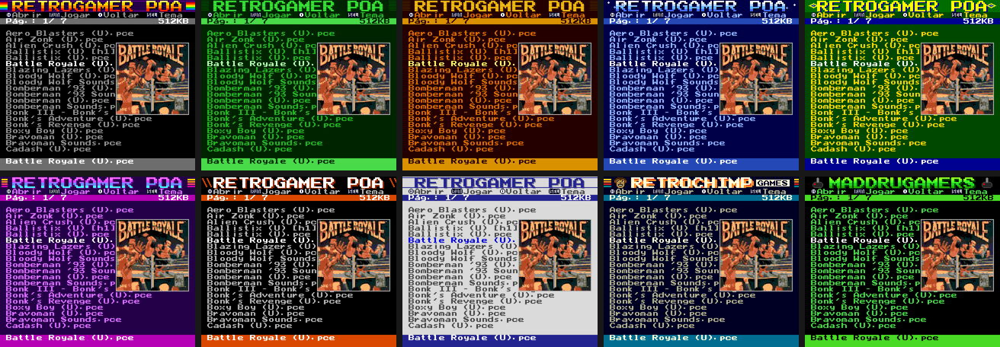

# Turbo EverDrive OS — Retrogamer POA (PT-BR)

Mod do sistema operacional (OS) do **Turbo EverDrive v1** da Krikzz para PC Engine / TurboGrafx-16.
Base: OS v4 original, de https://krikzz.com/pub/support/turbo-everdrive/v1/os/v4/.

**Versão atual: PT-BR v8** · Mod: **Retrogamer POA**, por **Antonio & The Nobre**



## O que o mod traz

| | |
|---|---|
|  | **Interface em português** com acentos de verdade: a fonte ganhou á à â ã é ê í ó ô õ ú ç, maiúsculas, ü º ª. **Banner Retrogamer POA** no topo e **linha de ajuda** com os botões. |
|  | **Capa do jogo** ao parar o cursor sobre ele. São 2.372 nomes de arquivo com capa, entre PC Engine e SuperGrafx, incluindo hacks, traduções e "Sounds". |
|  | **Tela do jogo** ao apertar RUN: capa, **Carregar**, **Favoritar / Remover favorito** e **Voltar**. Os jogos carregados entram na lista de **recentes**. |
|  | **Menu** (botão I na raiz): **Favoritos**, **Recentes** e **Sobre**. |
|  | **Listas de favoritos e recentes**: escolher um jogo leva direto até ele (o OS entra na pasta, o cursor vai até o jogo e a tela do jogo abre). Favoritos e recentes ficam salvos no `RGPOA.DAT`. |
|  | **Tela Sobre** com a versão do mod e os créditos. |
|  | Mensagens de carregamento e atualização traduzidas. |

**8 temas de cor com SELECT**, salvos no cartão SD: Original, Fósforo Verde, Âmbar, Azul, Brasil, Synthwave, Turbo e Papel.



Ao ligar aparece uma **splash screen** por 2 segundos. Qualquer botão pula.

## Botões

| Botão | Função |
|---|---|
| **II** | abre a pasta |
| **RUN** | abre a tela do jogo (Carregar já vem selecionado: RUN de novo carrega) |
| **I** | sobe uma pasta; na raiz, abre o **menu** (Favoritos / Recentes / Sobre) |
| **SELECT** | troca o tema (fica salvo) |
| ↑ ↓ ← → | navega; ← → trocam de página |

## Instalação

1. Baixe o `.zip` da [última release](../../releases/latest).
2. **Faça backup do seu cartão SD** (veja [Segurança](#segurança)).
3. Copie `TOS.PCE` e `RGPOA.DAT` para a **raiz** do SD.
4. Ligue o console, selecione `TOS.PCE` na lista e aperte **RUN**. Aparece "Atualizando o SO...": não desligue até terminar.

O `RGPOA.DAT` aparece na lista da raiz. Deixe ele lá: dele saem as capas, o tema salvo, os favoritos e os recentes. Sem ele o mod funciona, só que sem esses recursos.

A v8 usa o `RGPOA.DAT` no formato v3. Um `.dat` de versão anterior **precisa ser trocado** pelo da release: o antigo é ignorado (sem capas). Os favoritos e recentes de testes da v7 não são aproveitados.

### Limites
- O OS original da Krikzz mostra **no máximo 224 itens por pasta**. Pastas com mais arquivos têm jogos que nunca aparecem no console; vale dividi-las em subpastas.
- Depois de ir a um jogo pelos favoritos/recentes, o botão I volta para a raiz (e não para a pasta-mãe).
- Até 56 favoritos e 14 recentes.

### Voltar ao OS original
Baixe o `tos.pce` original da Krikzz (link acima), copie para a raiz do SD como `TOS.PCE`, selecione e aperte **RUN**.

## Segurança

O OS da Krikzz grava o firmware na flash do cartucho quando você roda o `TOS.PCE`. O mod não muda esse processo.

Sobre o cartão SD, o mod **só grava dentro do `RGPOA.DAT`**, e só nos 11 primeiros setores dele: o setor 0 (tema), 1–8 (favoritos) e 9–10 (recentes). Antes de cada gravação ele:
- relê o setor e confere a assinatura dele (`RGPOA-DAT-v2` no setor 0, `RGPOA-SLOT` + tipo + número nos outros). Se o arquivo estiver fragmentado no cartão, a assinatura não bate e nada é gravado;
- recusa qualquer setor fora desses 11 e fora da área de dados do FAT32.

FAT e diretórios nunca são gravados. Mesmo assim, faça backup do SD antes de instalar uma versão nova.

## Capas: como gerar o `RGPOA.DAT` para os seus jogos

A release traz um `RGPOA.DAT` pronto para o acervo `GAMES_PCENGINE` e para a coleção do autor. Para gerar um com os seus jogos:

```
pip install pillow
python tools/scrape.py  <pasta_dos_roms> [outra_pasta ...]   # casa ROMs com capas e baixa as que faltam
python tools/artpack.py                                      # gera out/RGPOA.DAT
python tools/artpack.py --keep E:\RGPOA.DAT                   # idem, mantendo tema, favoritos e recentes do .dat atual
```

O scraper casa primeiro pelo CRC32 da ROM (base No-Intro do libretro-database) e, se não achar, pelo título aproximado. Isso cobre hacks, traduções, bad dumps e "Sounds". As capas vêm do [libretro-thumbnails](https://github.com/libretro-thumbnails) (PC Engine e SuperGrafx), e as já baixadas estão em `art_cache/img/`.

O cartucho identifica o jogo pelo **nome do arquivo**, então o mesmo jogo em pastas diferentes mostra a mesma capa. Se renomear ou adicionar jogos, gere o `.dat` de novo. Use `--keep` com o `.dat` que está no SD para não perder tema, favoritos e recentes.

## Compilar o firmware

Requer Python 3 e Pillow. O OS original é baixado automaticamente do site da Krikzz e conferido pelo MD5.

```
python tools/build.py        # -> out/TOS.PCE
python tools/test_mod.py     # emulador headless: splash, menu, sobre, temas, carregamento
python tools/test_v3.py      # capas + salvamento do tema (precisa de uma imagem de SD em sdcard_dump)
python tools/test_v7.py      # tela do jogo, favoritos e recentes
python tools/test_v8.py      # menu, listas e "ir ao jogo"
python tools/screenshots.py  # gera docs/screenshots/
```

Para lançar uma versão nova, aumente `MOD_VERSION` em `tools/build.py`.

Detalhes técnicos (engenharia reversa, mapa de memória, protocolo do SD, formato do `RGPOA.DAT`) estão em [docs/TECNICO.md](docs/TECNICO.md). O histórico está em [CHANGELOG.md](CHANGELOG.md).

## Créditos e avisos

- Mod: **Retrogamer POA**, por Antonio & The Nobre.
- OS original, hardware e firmware do Turbo EverDrive: **Krikzz** (krikzz.com). Este projeto não é oficial.
- Capas: projeto [libretro-thumbnails](https://github.com/libretro-thumbnails). As artes pertencem aos seus respectivos donos e estão aqui sem fins lucrativos.
- Nenhuma ROM é distribuída aqui.
- O código das ferramentas (`tools/`) está sob licença MIT ([LICENSE](LICENSE)).
